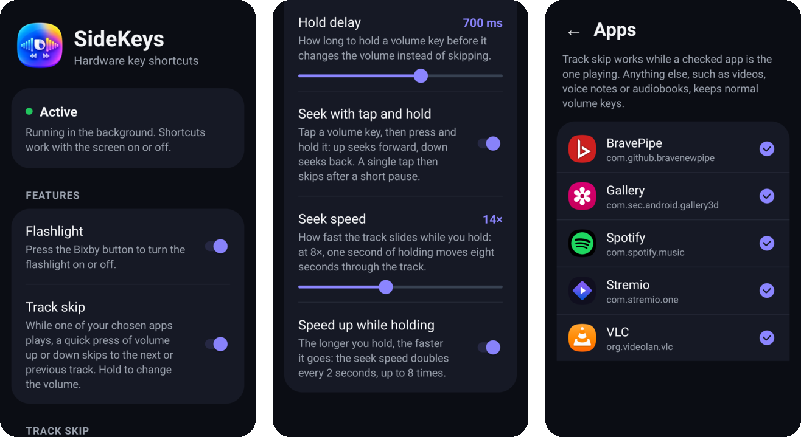

# SideKeys

Hardware key shortcuts for Samsung Galaxy phones:

- **Flashlight on the Bixby button.** Each press of the dedicated Bixby key turns the rear
  flashlight on or off, with the screen on or off.
- **Track skip on the volume keys.** While one of the music apps you choose is playing, a
  quick press of volume up or down skips to the next or previous track. Holding the key
  changes the volume as usual. Optionally, a tap followed by a hold seeks forward or back.
  Anything else that plays (videos, voice notes, audiobooks) keeps normal volume keys.

Both features can be switched on and off in the app. The app has no network access and its
Accessibility service cannot read screen content.



## Device compatibility

SideKeys needs **Android 10 or newer**.

| Feature | Works on |
|---|---|
| Flashlight on Bixby button | Samsung phones with a dedicated Bixby key **and** Android 10 or newer: Galaxy S10e, S10, S10+, S10 5G (tested on the S10e); Galaxy S9, S9+, Note9 (untested, see below) |
| Track skip on volume keys | Any Android 10+ phone |

Only some Samsung phones have a separate Bixby key: the Galaxy S8, S8+, Note8, S9, S9+, Note9
and the S10 family. Samsung removed it starting with the Galaxy Note10; on later models the
assistant moved to the side (power) key, so there is no Bixby key for SideKeys to use. The
S8, S8+ and Note8 stopped at Android 9 and cannot install SideKeys. The S9, S9+ and Note9 end
at Android 10 (One UI 2.x) and can install it.

The Bixby key is detected from One UI system log lines (see below). Those lines are One UI
internals: they were verified on One UI 4 (Android 12). On the S9 and Note9 (One UI 2.x) the
log lines may differ, so the flashlight feature is untested there; track skip does not depend
on them. Custom ROMs may log differently as well. Reports from other devices are welcome.

Tested on:

| Device | Firmware | Flashlight | Track skip | Screen off |
|---|---|---|---|---|
| Galaxy S10e | One UI 4.1, Android 12 | yes | yes | yes |

On other phones the volume shortcut works with the screen on; whether volume keys reach the
app with the screen off depends on the manufacturer's firmware.

| Key | Condition | Action |
|---|---|---|
| Bixby | flashlight feature on | toggle the rear flashlight |
| Volume up, tap (shorter than the hold delay) | a chosen app is playing, not in a call | next track |
| Volume down, tap | same | previous track |
| Volume up/down, held | same | media volume, one step every 150 ms |
| Volume up, tap then hold | same, seek option on | fast forward at the seek speed while held |
| Volume down, tap then hold | same, seek option on | rewind at the seek speed while held |
| Volume up/down, two taps | same, seek option on | two skips |
| Volume up/down | anything else | normal system behaviour |

### Track skip settings

- **Apps**: track skip only works while a checked app is the one playing, whether it is open
  on screen or playing in the background. Pre-checked: common music players (Spotify, YouTube
  Music, Samsung Music, Apple Music, Deezer, Amazon Music, TIDAL, SoundCloud, Pandora,
  Poweramp, Musicolet, Retro Music, Gramophone) when installed. Edit the list in the app.
- **Hold delay** (250 to 1000 ms, default 500): how long a press must last to count as a hold.
  A tap is anything shorter.
- **Seek with tap and hold** (off by default): tap a volume key, then within 0.3 s press and
  hold it to seek. Because SideKeys must wait those 0.3 s to tell a tap from the start of this
  gesture, a single tap skips 0.3 s later while this option is on.
- **Seek speed** (2× to 30×, default 8×): how fast the position slides while you hold. At 8×,
  one second of holding moves eight seconds through the track, forward or back. SideKeys moves
  the position in small `seekTo` steps every 150 ms, so it slides like fast forward on a CD
  player (you hear short fragments) instead of jumping.
- **Speed up while holding** (on by default): the longer you hold, the faster it goes. The
  seek speed doubles every 2 seconds held, up to 8 times (with the default 8×: 8×, 16×, 32×,
  64×), and starts over at the next hold.

Track skip needs **notification access**. Android only tells an app which app is playing,
and lets it skip or seek there, through `MediaSessionManager.getActiveSessions()`, which
requires notification access. SideKeys registers an empty notification listener for that and
never reads notifications. Without the access, the volume keys stay normal. Grant it in
Settings > Notifications > Notification access (the app shows a shortcut), or over adb:

```
adb shell cmd notification allow_listener com.unl0cker.bixby/com.unl0cker.bixby.MediaListener
```

With a player that does not support seeking, SideKeys sends `MEDIA_FAST_FORWARD` and
`MEDIA_REWIND` instead, which many players ignore.

Release notes for each version are in [CHANGELOG.md](CHANGELOG.md).

## Install

1. Download `sidekeys-<version>.apk` from the [Releases](../../releases) page and install it
   (`adb install sidekeys-<version>.apk`, or open the file on the phone).
2. For the flashlight feature, grant log access once from a computer with adb:
   ```
   adb shell pm grant com.unl0cker.bixby android.permission.READ_LOGS
   ```
3. Open SideKeys and tap **Open Accessibility settings**, then turn SideKeys on. For track
   skip, also tap **Open notification access settings** and allow SideKeys.
   On Android 13 and newer, sideloaded apps first need App info > menu (three dots) >
   **Allow restricted settings** before Accessibility can be turned on, and Android asks
   once to allow log access.

Grant log access before turning the service on: a process only gets log access when it
starts. If the service was already on, turn it off and on again. Do not use
`adb shell am force-stop` for this, because force-stopping an Accessibility service's app
also turns the service off.

If another app also handles the Bixby key (for example Bixby Button Actions), turn it off,
or both apps toggle the flashlight and cancel each other out.

## How it works

### Volume keys

An Accessibility service with `flagRequestFilterKeyEvents` only (`canRetrieveWindowContent`
is false and no event types are requested) receives hardware key presses. On a volume key
press it asks `MediaSessionManager` for the session in `STATE_PLAYING`. When that session
belongs to a chosen app and the phone is not in a call, it holds the press:

- released before the hold delay: calls `skipToNext` or `skipToPrevious` on that session
  (with the seek option on, after waiting 0.3 s for a second press);
- held longer: adjusts the media volume one step every 150 ms and shows the volume panel;
- tapped, then pressed again and held: scrubs the playing session forward or back (see Track
  skip settings).

In every other case the key passes through untouched.

### Bixby key

The Bixby key is scancode 703 (`WINK` in `Generic.kl`). One UI keeps this key for itself and
does not pass it to apps (`interceptKeyTq interceptKeyResult=4`), so Accessibility services
never receive it. The service therefore runs `logcat` restricted to two system_server tags:

```
InputReader: Input event(9): value=1|0            hardware key down/up (any side key)
PhoneWindowManagerExt: getIntentBixbyService ...   logged for the Bixby key only
```

A `getIntentBixbyService` line right after a key-down is one Bixby press, and the flashlight is
toggled through `CameraManager.setTorchMode`, which needs no permission. Reading the log
requires `READ_LOGS`, a development permission that only adb can grant. The log watcher only
runs while the flashlight feature is on.

### Permissions

| Permission | Why |
|---|---|
| `READ_LOGS` (granted over adb) | Bixby key detection |
| Accessibility service (key events only) | volume keys; keeps the app running for the log watcher |
| Notification access (empty listener) | track skip: which app is playing, skipping and seeking in it; notifications are not read |
| Package visibility for launcher apps (`<queries>`) | listing apps in the Apps screen |

No internet permission, no camera permission, no storage access.

## Build

The app has no library dependencies and can be built with the Android SDK tools alone:

- Android SDK with build-tools and the `android-36.1` platform
- JDK 17 or newer

```
echo "sdk.dir=/path/to/Android/Sdk" > local.properties   # or export ANDROID_HOME
scripts/build.sh debug     # build/manual/app-debug.apk, signed with the Android debug key
```

`scripts/env.sh` finds the tools: `ANDROID_HOME` or `sdk.dir`, `JAVA_HOME` or `javac` on
`PATH`, the newest installed build-tools (override with `BUILD_TOOLS`) and the
`android-36.1` platform (override with `PLATFORM`). Versions and the application ID are read
from `app/build.gradle.kts`, so the project also opens in Android Studio. Timings are
constants in `KeyService.java` (`LONG_PRESS_MS`, `REPEAT_MS`).

## Signing your own build

A debug build is fine for trying the app. For a build you keep and update, sign it with your
own key. The key never goes into the repository: `.gitignore` excludes `*.jks`, `*.p12`
and `*.keystore`, and the password is only typed at the prompt.

1. Create a key once, outside the repository, and keep a backup of it and its password.
   Android only installs an update over an app signed with the same key.
   ```
   keytool -genkeypair -v -keystore ~/keys/sidekeys.jks -alias sidekeys \
       -keyalg RSA -keysize 4096 -validity 10000 -dname "CN=Your Name"
   ```
2. Tell the script where it is (for example in your shell profile):
   ```
   export SIDEKEYS_KEYSTORE=~/keys/sidekeys.jks
   export SIDEKEYS_KEY_ALIAS=sidekeys
   ```
3. Build and sign:
   ```
   scripts/sign-release.sh    # dist/sidekeys-<version>.apk
   ```
   apksigner asks for the keystore password, then prints the certificate and the APK
   checksum.

An APK signed with your key cannot be installed over one signed with another key (such as
the release from this page): uninstall the other one first, then grant log access and turn
on the Accessibility service again.

## Disclaimer

Not affiliated with or endorsed by Samsung. Galaxy, Bixby and One UI are trademarks of
Samsung Electronics.
